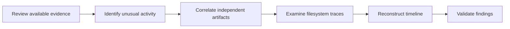

# JobApplicant | A Digital Forensics Investigation

> **The file was gone. The investigation wasn't over.**
>
> A hands-on investigation into suspicious activity in a Windows environment, and what it takes to reconstruct an incident when parts of the evidence are no longer visible.

  

**Challenge:** [Hack The Box — JobApplicant Sherlock](https://app.hackthebox.com/sherlocks/JobApplicant?tab=play_sherlock)  
**Focus:** DFIR · Windows Forensics · Log Analysis · Active Directory Investigation  
**Investigation documented:** September 2026  
**Author:** KHaled_Kin

---

## The investigation, in brief

A college's job application portal became the starting point for an investigation into suspicious activity across its Windows infrastructure.

The task was to work backward from the available evidence: identify unusual behavior, establish when it happened, and connect individual traces into a reliable account of the incident. That meant examining evidence from several places rather than relying on one log or one tool.

One part of the case was especially challenging. Information I needed was no longer directly accessible as an ordinary file. Instead of treating that as a dead end, I investigated how NTFS records file information and wrote a **Python script to perform MFT record fixup and parse its attributes**.

This repository documents the skills, investigative approach, and technical work involved. It deliberately avoids publishing challenge answers or a step-by-step solution while the Sherlock's retirement status has not been confirmed.

## At a glance

| | |
|---|---|
| **Scenario** | Investigation of a suspected compromise in a Windows-based environment |
| **Primary objective** | Reconstruct activity and support conclusions with forensic evidence |
| **Evidence reviewed** | IIS web logs, Windows Event Logs, NTFS metadata, and the USN Journal |
| **Technical highlight** | Custom Python analysis of an NTFS MFT record |
| **Core skills** | Timeline reconstruction, artifact correlation, filesystem analysis, and investigative scripting |
| **Outcome** | Completed the 19 investigation tasks and documented the analysis and lessons learned |

## How I approached it

I treated each artifact as one part of a larger story. A log entry can show that something happened; another artifact can help establish *when*, *how*, or whether a proposed explanation is supported.

The investigation involved four main areas:

1. **Web activity:** Reading IIS logs to separate routine requests from patterns that deserved closer investigation.
2. **Windows events:** Examining security events in context instead of relying on isolated event IDs.
3. **Filesystem artifacts:** Using NTFS metadata and the USN Journal to understand file activity, including traces left after deletion.
4. **Timeline reconstruction:** Comparing timestamps and activity across sources to build a consistent account of what occurred.

## Technical highlight: Going deeper into NTFS

The part I found most rewarding was working with the **Master File Table (`$MFT`)**.

The MFT is a central NTFS structure that stores records describing files and directories. Even when a file is no longer present in a normal directory listing, its filesystem metadata may still contain useful forensic information, depending on whether that information has been overwritten or reused.

I first used an MFT analysis utility to inspect the available records. When I needed a closer look at the record structure, I worked with its binary representation and wrote Python code to:

- Read the NTFS **Update Sequence Array (USA)** metadata.
- Validate and apply **MFT record fixup**.
- Walk through the record's NTFS attributes.
- Distinguish resident from non-resident attributes.
- Decode relevant metadata and extract recoverable resident content where present.

This was more than a scripting exercise. I had to understand *why* the fixup process exists and how the record is structured before I could interpret its contents correctly.

**The lesson:** A missing file and missing evidence are not necessarily the same thing. Recoverability depends on the artifacts that remain, so conclusions must come from what those artifacts actually support.

<!-- Optional: Add an original, redacted screenshot after uploading it to the repository.

-->

## Evidence and tools

| Artifact / tool | How I used it |
|---|---|
| **IIS web server logs** | Investigated HTTP activity and identified patterns worth following up. |
| **Windows Security Event Logs (`.evtx`)** | Reviewed authentication and security-related activity as part of the broader timeline. |
| **`$MFT`** | Examined NTFS file records and metadata when a file was not directly accessible. |
| **USN Journal (`$UsnJrnl:$J`)** | Traced filesystem changes, including creation and deletion activity. |
| **`analyzemft`** | Parsed the MFT into a more convenient format for initial examination. |
| **`evtxexport`** | Converted Windows event records into a readable format for analysis. |
| **`usn.py`** | Parsed USN Journal records to examine filesystem activity. |
| **Python (`struct`)** | Built a custom parser for MFT record fixup and attribute inspection. |

## What this case taught me

**Follow the evidence, not the first assumption.** A suspicious event is a starting point, not a conclusion. Correlating independent sources made the investigation much more reliable.

**Understand what your tools are reading.** Learning the NTFS record structure helped me move past a limitation I encountered during the investigation, rather than simply trying more tools.

**Write code when the investigation calls for it.** The Python script was a practical response to a specific analysis problem, not a separate programming exercise.

**Make the findings understandable.** The value of forensic work isn't just finding technical artifacts. It's explaining what they mean, how they relate, and how confident we can be in the conclusions.

## Defensive perspective

The case reinforced several areas that matter in real incident response:

- Treating uploaded files as untrusted and separating storage from executable application paths.
- Securing access to web application directories and configuration files.
- Reviewing Active Directory and certificate-related permissions.
- Keeping useful security and filesystem logs available for investigation.
- Correlating evidence across systems instead of relying on a single detection or timestamp.

These are general defensive lessons, not a claim that every control was assessed or remediated during this Sherlock.

## About publication

This is a **personal learning and investigation portfolio**, based on an authorized Hack The Box lab. It is not a real-world incident report.

---

**The biggest takeaway:** I came into the investigation looking for evidence. I left with a better understanding of how to find answers when the obvious evidence is no longer there.
